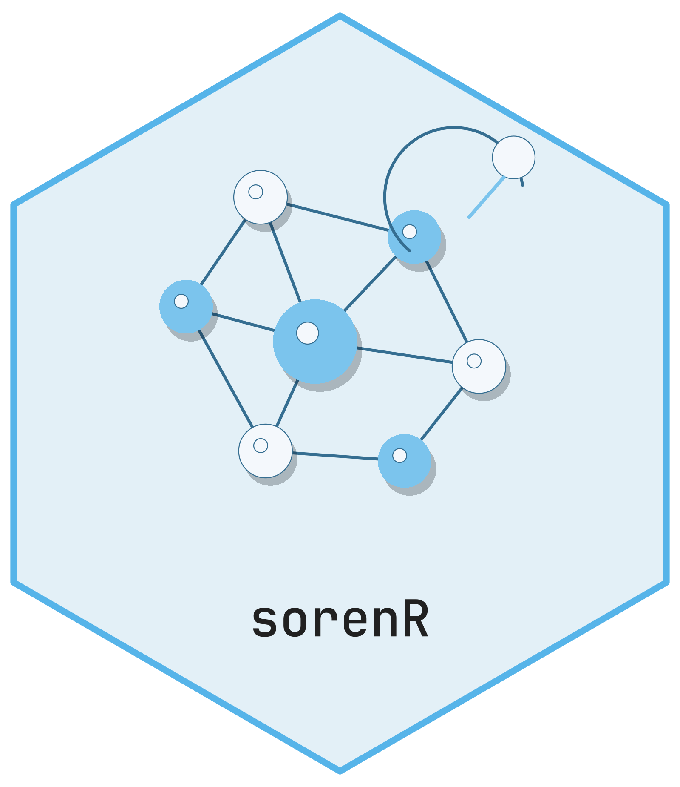

# sorenR <picture class="cttir-readme-logo"><source class="cttir-logo-dark-source" media="(prefers-color-scheme: dark)" srcset="man/figures/logo-with-name-dark.png" /></picture>

Experimental **Self-Organizing Representations with Evolving Neighborhoods** in
pure R. This is an early research implementation, not a validated new method.
Novelty, benefit over existing methods and suitability for scientific inference
remain unestablished.

```r
library(sorenR)
x <- cbind(time = seq_len(80) / 10, wave = sin(seq_len(80) / 5))
model <- soren_fit(x, control = soren_control())
z <- soren_transform(model, x[1:10, , drop = FALSE])
updated <- soren_update(model, x + 0.1)
soren_diagnostics(updated)
```

The package fits a bounded prototype codebook and mutual-neighbor graph, then
optimizes a smoothed attraction/repulsion objective. The out-of-sample map uses
all-prototype radial-basis interpolation. Training means and scales remain frozen.
Named feature columns must match exactly, including their order.

Updates check mean squared **raw coordinate displacement on old retained anchors**
after prototype, bandwidth and layout changes. Same-size proposals can be shortened;
infeasible growth proposals are rolled back. Inspect `last_update` in diagnostics:
`accepted`, `rollback` and `frozen` have different meanings. This bound does not
control every point, unseen observations or cumulative displacement across updates.

`stability_mode` offers `fixed` (default), `adaptive`, `frozen` and `unrestricted`.
The adaptive mode uses an **uncalibrated support heuristic**, not a statistical
change test or evidence of a biological cause. Fixed and adaptive budgets are in
squared output-coordinate units. No alignment or rescaling conceals displacement.

Memory combines a random reservoir of initial training and **accepted-batch** rows
with coverage slots. Rejected and frozen batches do not enter memory. Coverage is
biased, and an observation can occupy both kinds of slot. The combined matrix is
cached, so physical stored row slots are at most twice `memory_size`. Prototypes
and memory can contain sensitive derived information; they are not anonymized.

Dense finite numeric matrices are supported. Sparse matrices and data frames are
rejected explicitly. State is bounded in stream length, with dense graph storage
quadratic in prototype count. This implementation is intended for small CPU studies;
there is no million-point performance claim. Transform is chunked and preserves
caller random state. Empty transform batches are supported.

The map lies inside the convex hull of prototype coordinates, so it cannot reliably
extrapolate beyond training support. Graph weights can numerically underflow to zero;
these pairs are treated as nonedges. Disconnected components need not have a finite
loss minimizer. The finite optimization budget does not imply convergence. Growth
requires repeated batch-level support evidence; merging/pruning and calibrated drift
control are not implemented in this version.

`soren_embedding()` returns retained replay slots or prototype coordinates, not
all historical observations. `soren_save()`/`soren_load()` support trusted local RDS
files with schema validation. Use `soren_transform()` for observations held externally.
Geometry stress, support coverage and anchor displacement are distinct diagnostics,
not confidence probabilities. Perturbation and refit sensitivity require separate
experiments.

`soren_neighborhood_audit(model, query, reference, k = 15L)` compares supplied
query-to-reference neighborhoods under frozen input preprocessing and the current
embedding. It returns per-query expected recall, aggregate counts, and boundary-tie
diagnostics. Supply independent evaluation matrices and explicit positional
`exclude_reference` indices when self-matches need removal. Ties use independent
uniform boundary choices analytically: identical fully tied spaces score k/N,
not one. This geometric audit does not establish biological validity or superiority.
Distance work is chunked; input validation/copies and returned rows still use memory.

Install a locally built source package with `R CMD INSTALL sorenR_0.0.1.tar.gz`.
Only base/recommended R packages are runtime dependencies. Testthat is used for tests.
No network access is required by the package, its examples or tests.

Read the [getting-started vignette](vignettes/sorenR.Rmd) for a complete example.
After installation, open it with `vignette("sorenR", package = "sorenR")`.

## Branding

Editable R artwork and regeneration instructions are in [tools/branding](https://github.com/CTTIR/sorenR/blob/main/tools/branding/README.md).
