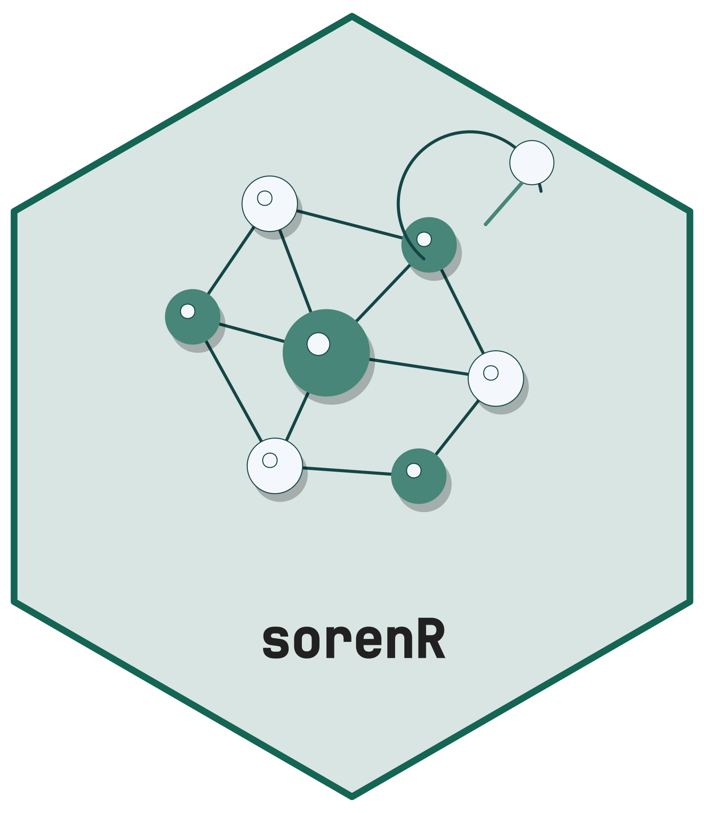

# sorenR <picture class="cttir-readme-logo"><source class="cttir-logo-dark-source" media="(prefers-color-scheme: dark)" srcset="man/figures/logo-with-name-dark.png" /></picture>

**Self-Organizing Representations with Evolving Neighborhoods**: a low-dimensional
reference map that can keep taking new data without its existing coordinates
drifting. The package is experimental and has only been tried on synthetic data.

```r
library(sorenR)
model   <- soren_fit(x)                      # x: dense numeric matrix
y       <- soren_transform(model, x)
updated <- soren_update(model, new_batch)
soren_diagnostics(updated)$certificate
soren_transform(updated, x, reference = "origin")   # identical to y
```

## What an update guarantees

The map is a weighted average over prototypes,
`f(x) = sum_j w_j(x) * (y_j + A_j (x - c_j))`, with normalized radial-basis
weights `w_j`. An update

* never changes an existing prototype `c_j`, its bandwidth or its local linear
  map `A_j`;
* appends prototypes only where new observations fall outside calibrated
  support (see below);
* keeps every existing layout coordinate `y_j` within a lifetime radius of the
  coordinate it had when it was created. The radius is `stability_radius`
  (default 0.05) times the root mean square radius of the fitted layout.

It follows that an observation with share `w` of its weight on prototypes added
since the fit lies at most `(1 - w) * origin_shift_max` from its originally
fitted position, plus `w` times the distance between the new part of the map and
that position. The bound holds for every point, including points the model has
never seen, and it is a lifetime bound, not a per-update one.
`soren_diagnostics()` reports `origin_shift_max`, the radius and whether it
holds; `soren_transform(diagnostics = TRUE)` reports `w` and the actual
displacement per observation.

Two consequences:

* A batch with no flagged structure leaves the map exactly as it was.
* `soren_transform(reference = "origin")` evaluates the originally fitted map
  from any later model version, so published coordinates stay reproducible.

What the guarantee does not cover: observations that sit on newly added
prototypes (`w` close to one) are by construction mapped somewhere new, and the
bound says nothing about how well the map represents the data.

## Calibrated novelty and growth

At fit, up to a fifth of the rows (at most `calibration_size`) are held out and
never used to place prototypes. A new observation's distance to its nearest
prototype, in bandwidth units, is turned into a conformal p-value against those
held-out scores. Observations at or below `novelty_alpha` are flagged. Where at
least `growth_min_support` flagged observations lie close together, a prototype
is appended at their mean; it is narrowed or dropped until new prototypes take
at most `growth_intrusion` of the map weight on every calibration observation
and every replay observation the present model does not flag.

P-values are valid on average for observations exchangeable with the
calibration rows. A batch effect or measurement shift breaks that assumption
and will be flagged as novel. With fewer than twenty held-out rows nothing is
flagged; `soren_diagnostics()$calibration` reports the level actually in use.
Flags are per observation and are not corrected for multiplicity; the support
requirement is a heuristic safeguard, not a formal error rate for growth.

## Fitting

Columns are centered and scaled once and that preprocessing is frozen.
Prototypes are chosen by farthest-point sampling and refined; they are joined
into a nearest-neighbor graph and laid out by stress majorization on graph
path lengths (`geodesic = TRUE`) or Euclidean distances. Each prototype gets
its own bandwidth and, with `local_linear = TRUE`, a frozen local linear map.

Check the result on your own data: `soren_neighborhood_audit(model, query,
reference, k)` compares query-to-reference neighborhoods in the standardized
input and in the embedding, with exact handling of ties.

## Limits

* Dense finite numeric matrices only; sparse matrices and data frames are
  rejected. Named feature columns must match training exactly, in order.
* Prototype storage and layout are quadratic in the number of prototypes, and
  graph path lengths are cubic. The package has been run with up to 512
  prototypes and is meant for a few hundred.
* Prototypes are never merged or removed, and existing prototypes do not track
  slow change inside their support.
* Far from all prototypes the local linear maps extrapolate linearly and
  should not be trusted; such observations are flagged as novel.
* The model stores prototypes, held-out calibration rows and replay rows in
  standardized form. They can contain sensitive information and are not
  anonymized. `soren_load()` is for trusted local files only.
* `soren_embedding()` returns retained replay slots or prototypes, not every
  historical observation.

## Related work

The map form is not new: normalized radial-basis out-of-sample maps appear in
kernel t-SNE (Gisbrecht, Schulz and Hammer 2015,
[doi:10.1016/j.neucom.2013.11.045](https://doi.org/10.1016/j.neucom.2013.11.045)),
control points with local affine maps in LAMP (Joia et al. 2011,
[doi:10.1109/tvcg.2011.220](https://doi.org/10.1109/tvcg.2011.220)), and
landmark layouts on path lengths in landmark Isomap (de Silva and Tenenbaum
2002). Stress majorization follows de Leeuw and Mair (2009,
[doi:10.18637/jss.v031.i03](https://doi.org/10.18637/jss.v031.i03)) and conformal
p-values for outlier testing follow Bates et al. (2023,
[doi:10.1214/22-aos2244](https://doi.org/10.1214/22-aos2244)). What this package
adds is the update protocol and its displacement bound. No comparison with
other methods on real data has been published.

## Installation

Install the development version with `remotes::install_github("CTTIR/sorenR")`.
Only base and recommended R packages are needed at run time; no network access
is required by the package, its examples or its tests.

Read the [getting-started vignette](vignettes/sorenR.Rmd) for a complete example.

## Branding

Editable R artwork and regeneration instructions are in [tools/branding](https://github.com/CTTIR/sorenR/blob/main/tools/branding/README.md).
