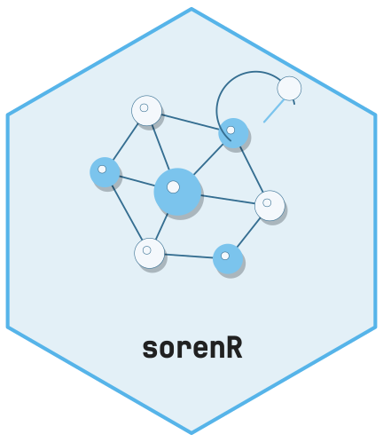
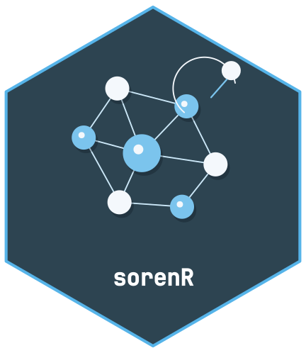

<!-- cttir-vignette-logo: start -->
<style>
.cttir-vignette-logo { float: right; width: 120px; max-width: 30%; margin: 0 0 1rem 1.5rem; }
.cttir-vignette-logo img { width: 100%; height: auto; border: 0; background: transparent; box-shadow: none; }
.cttir-vignette-logo .cttir-vignette-logo-light { display: block; }
.cttir-vignette-logo .cttir-vignette-logo-dark { display: none; }
@media (prefers-color-scheme: dark) {
  .cttir-vignette-logo .cttir-vignette-logo-light { display: none; }
  .cttir-vignette-logo .cttir-vignette-logo-dark { display: block; }
}
[data-bs-theme="light"] .cttir-vignette-logo .cttir-vignette-logo-light { display: block; }
[data-bs-theme="light"] .cttir-vignette-logo .cttir-vignette-logo-dark { display: none; }
[data-bs-theme="dark"] .cttir-vignette-logo .cttir-vignette-logo-light { display: none; }
[data-bs-theme="dark"] .cttir-vignette-logo .cttir-vignette-logo-dark { display: block; }
</style>
<div class="cttir-vignette-logo">
  
  
</div>
<!-- cttir-vignette-logo: end -->

```{r setup, include=FALSE}
knitr::opts_chunk$set(collapse = TRUE, comment = "#>")
```


**Self-Organizing Representations with Evolving Neighborhoods** is an experimental
pure-R prototype graph representation. Its scientific novelty and benefit over
existing methods are not established. This example uses only synthetic data.

## Fit a representation

Rows are observations and columns are numeric features. Preprocessing is learned
from the training matrix and stays frozen for later transforms and updates.

```{r fit}
library(sorenR)
t <- seq(0, 4 * pi, length.out = 80)
x <- cbind(time = t, sine = sin(t), cosine = cos(t))
control <- soren_control(max_prototypes = 16L, initial_prototypes = 8L,
                         memory_size = 40L, seed = 42L)
model <- soren_fit(x, n_components = 2L, control = control)
model
```

## Transform new observations

The frozen transform does not retrain the model or consume random numbers.
Feature names and their order must match training.

```{r transform}
t_next <- seq(4 * pi, 4.5 * pi, length.out = 12)
x_next <- cbind(time = t_next, sine = sin(t_next), cosine = cos(t_next))
mapped <- soren_transform(model, x_next, diagnostics = TRUE)
head(mapped$coordinates)
head(mapped$support)
```

Support ratios are uncalibrated coverage diagnostics, not confidence probabilities.
The output lies inside the convex hull of prototype coordinates; far-away inputs
are not reliable extrapolations.

## Audit independent neighborhoods

Training stress and independent neighbor retrieval measure different properties.
Supply query and reference matrices separately; the audit uses frozen preprocessing
and the current map without fitting or retaining either bank. These deterministic
synthetic observations illustrate the API, rather than a scientific validation.

```{r neighborhood-audit}
t_query <- seq(0.15, 3.85 * pi, length.out = 9)
t_reference <- seq(0.07, 3.93 * pi, length.out = 31)
query <- cbind(time = t_query, sine = sin(t_query), cosine = cos(t_query))
reference <- cbind(time = t_reference, sine = sin(t_reference), cosine = cos(t_reference))
audit <- soren_neighborhood_audit(model, query, reference, k = 5L, chunk_size = 8L)
audit$summary
head(audit$per_query)
```

Recall is expected overlap under independent uniform choices within exact boundary
ties, computed without random draws. Identical fully tied neighborhoods score k/N,
not one; boundary sizes and inclusion weights make this visible. Duplicate values
remain separate candidates. Self-matches are removed only when explicitly indexed
with `exclude_reference` (zero means no exclusion), never from row names or values.
For the same matrix in both arguments, use `exclude_reference = seq_len(nrow(query))`.
The caller must establish independence from fitting or tuning. This diagnostic is
uncalibrated and does not establish biological validity or methodological superiority.

The audit evaluates the existing map one row at a time so block size cannot change
its reduction path; bulk transformation may differ at floating-point roundoff.
Two reference passes bound distance workspace, with an additional k-selection
buffer. Caller inputs, validation/coercion copies, and per-query output still use
memory. Repeated mapping favors reproducible small CPU audits over throughput.

## Update and inspect the result

An update returns a new model. The default fixed budget checks mean squared raw
coordinate displacement on the old retained anchors. Infeasible proposals can be
shortened or rolled back; inspect the status before interpreting adaptation.

```{r update}
updated <- soren_update(model, x_next)
checks <- soren_diagnostics(updated)
checks$last_update
```

A finite-anchor mean budget does not constrain every observation or total movement
across many updates. Adaptive mode uses an uncalibrated heuristic; it is not a
statistical test of drift. Frozen and unrestricted modes are also available for
controlled comparisons.

## Retained coordinates and model files

```{r retained}
head(soren_embedding(updated, type = "prototypes"))
checks$retained_slots
```

Replay memory contains bounded reservoir and coverage slots from training and
accepted batches. `soren_embedding()` does not return every historical observation.
Use `soren_transform()` for data stored separately.

Save with `soren_save(updated, "model.rds")` and reload with
`soren_load("model.rds")`. Only load trusted files. Prototypes and retained replay
may contain sensitive derived information and are not anonymized.

Dense finite matrices are supported. Sparse inputs, calibrated drift control,
and prototype merging/pruning are not implemented in this version.
