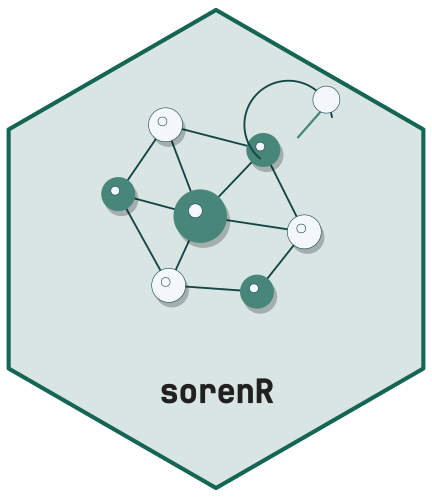

<!-- cttir-vignette-logo: start -->
<style>
.cttir-vignette-logo { float: right; width: 120px; max-width: 30%; margin: 0 0 1rem 1.5rem; }
.cttir-vignette-logo img { width: 100%; height: auto; border: 0; background: transparent; box-shadow: none; }
.cttir-vignette-logo .cttir-vignette-logo-light { display: block; }
.cttir-vignette-logo .cttir-vignette-logo-dark { display: none; }
@media (prefers-color-scheme: dark) {
  .cttir-vignette-logo .cttir-vignette-logo-light { display: none; }
  .cttir-vignette-logo .cttir-vignette-logo-dark { display: block; }
}
[data-bs-theme="light"] .cttir-vignette-logo .cttir-vignette-logo-light { display: block; }
[data-bs-theme="light"] .cttir-vignette-logo .cttir-vignette-logo-dark { display: none; }
[data-bs-theme="dark"] .cttir-vignette-logo .cttir-vignette-logo-light { display: none; }
[data-bs-theme="dark"] .cttir-vignette-logo .cttir-vignette-logo-dark { display: block; }
</style>
<div class="cttir-vignette-logo">
  
  
</div>
<!-- cttir-vignette-logo: end -->

```{r setup, include=FALSE}
knitr::opts_chunk$set(collapse = TRUE, comment = "#>")
```


**Self-Organizing Representations with Evolving Neighborhoods** fits a
low-dimensional reference map that can take new batches without its existing
coordinates drifting. The package is experimental; this example uses only
synthetic data.

## Fit a map

Rows are observations and columns are numeric features. Preprocessing is learned
from the training matrix and stays frozen.

```{r fit}
library(sorenR)
set.seed(1)
t <- runif(400, 0, 4 * pi)
x <- cbind(time = t, sine = sin(t), cosine = cos(t)) + rnorm(1200, sd = 0.05)
control <- soren_control(max_prototypes = 48L, initial_prototypes = 32L,
                         memory_size = 80L, seed = 42L)
model <- soren_fit(x, n_components = 2L, control = control)
model
```

A fifth of the rows were held out to calibrate novelty scores:

```{r calibration}
soren_diagnostics(model)$calibration
```

## Transform new observations

The transform is deterministic. Feature names and their order must match
training. Support diagnostics give, per observation, the distance to the nearest
prototype in bandwidth units, its conformal p-value against the held-out rows,
and whether it is flagged as novel.

```{r transform}
t_new <- runif(6, 0, 4 * pi)
inside <- cbind(time = t_new, sine = sin(t_new), cosine = cos(t_new))
mapped <- soren_transform(model, inside, diagnostics = TRUE)
mapped$coordinates
mapped$support
```

P-values are valid on average for observations exchangeable with the calibration
rows. They are not posterior probabilities, and a measurement shift will be
flagged just like a new population.

## Update with familiar data

A batch from the same distribution rarely contains flagged structure. The update
then leaves the map exactly as it was.

```{r update-unchanged}
t_batch <- runif(60, 0, 4 * pi)
batch <- cbind(time = t_batch, sine = sin(t_batch), cosine = cos(t_batch)) +
  rnorm(180, sd = 0.05)
same <- soren_update(model, batch)
soren_diagnostics(same)$last_update$status
identical(soren_transform(same, x), soren_transform(model, x))
```

## Update with a new population

Observations beyond the fitted range are flagged. Where enough of them lie close
together, prototypes are appended; existing prototypes are untouched and their
layout coordinates stay within the lifetime radius.

```{r update-growth}
t_far <- runif(60, 5 * pi, 5.5 * pi)
far <- cbind(time = t_far, sine = sin(t_far), cosine = cos(t_far)) +
  rnorm(180, sd = 0.05)
grown <- soren_update(same, far)
record <- soren_diagnostics(grown)$last_update
record[c("status", "flagged", "growth", "anchor_displacement_max")]
soren_diagnostics(grown)$certificate
```

While the certificate holds, an observation with share `w` of its weight on
added prototypes is at most `(1 - w) * origin_shift_max` away from where the
original map put it, plus `w` times the distance to the new part of the map.
This covers observations the model has never seen.

```{r bound}
support <- soren_transform(grown, x, diagnostics = TRUE)$support
summary(support$origin_displacement)
max(support$new_weight)
```

The original map itself is still available from the updated model:

```{r origin}
identical(soren_transform(grown, x, reference = "origin"),
          soren_transform(model, x))
```

## Audit neighborhoods

The bound is about stability, not about quality. To check how well the map keeps
neighborhoods, compare query-to-reference neighbors in the standardized input
and in the embedding on data that was not used for fitting.

```{r neighborhood-audit}
t_q <- runif(40, 0, 4 * pi); t_r <- runif(200, 0, 4 * pi)
query <- cbind(time = t_q, sine = sin(t_q), cosine = cos(t_q))
reference <- cbind(time = t_r, sine = sin(t_r), cosine = cos(t_r))
audit <- soren_neighborhood_audit(model, query, reference, k = 10L)
audit$summary$mean_recall_at_k
```

Recall is expected overlap under uniform choices within exact distance ties,
computed without random draws. Self-matches are removed only when indexed with
`exclude_reference`. The audit is a geometric diagnostic and does not establish
biological validity.

## Retained coordinates and model files

```{r retained}
head(soren_embedding(grown, type = "prototypes"), 3)
soren_diagnostics(grown)$retained_slots
```

`soren_embedding()` returns retained replay slots or prototypes, not every
historical observation; use `soren_transform()` for data stored separately.
Save with `soren_save(grown, "model.rds")` and reload with
`soren_load("model.rds")`. Only load trusted files. The model stores prototypes
and standardized calibration and replay rows, which are not anonymized.
